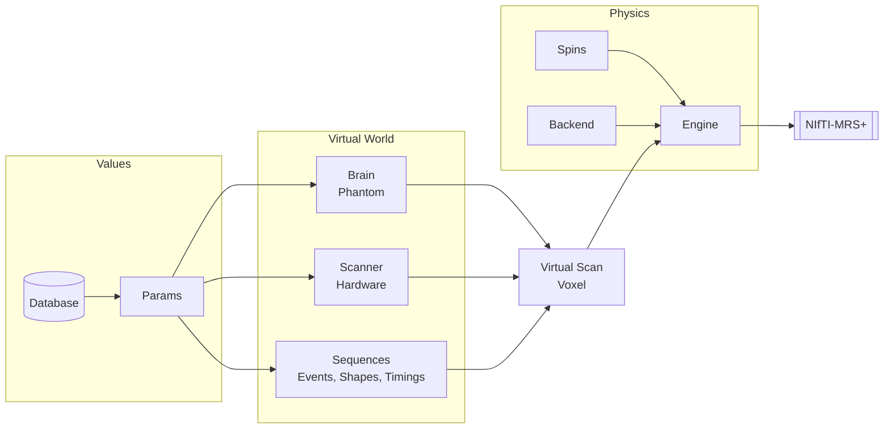

<div align="center">
  
  <h1 style="margin-top: 5px; margin-bottom: 5px;">MRSandbox</h1>
  <p style="margin-top: 0px;"><em>A simulation sandbox for magnetic resonance spectroscopy</em></p>
</div>

---

MRSandbox creates magnetic resonance spectra from first principles. A virtual brain provides the
tissue composition at any voxel position, a virtual scanner provides the field strength and the
hardware limits, and fully flexible pulse sequences probe both through a density matrix engine.
Every quantity is a configurable parameter that can be fixed, sampled from literature ranges, or
read from a quantitative map. The simulations are written with Keras operations and run batched
and differentiable on JAX, PyTorch, and TensorFlow.

```python
from mrsandbox import Brain, Press, Scanner, VirtualScan

brain = Brain.load("icbm152")                      # the MNI average brain, fetched once and cached
scan  = VirtualScan(brain, Scanner.preset("generic_3t"), Press(te1_s=0.011, te2_s=0.019))
data  = scan.voxel(position_mm=(10, -20, 5), size_mm=20).acquire(seed=7)    # NIfTI-MRS
```

> MRSandbox is under active development and grows with my research. It is a personal research toolbox and interfaces are adjusted as we see fit.

## Install

```
pip install "mrsandbox[jax]"
```

Python 3.11 or newer. The package runs on any one Keras backend and brings none of its own: `pip install mrsandbox` alone needs `jax`, `torch` or `tensorflow` present, and the extras `mrsandbox[jax]`, `mrsandbox[torch]` and `mrsandbox[tensorflow]` add one. JAX is the one the physics is measured on. Where several are installed, `KERAS_BACKEND` names the one used, else Keras's own default (`~/.keras/keras.json`, TensorFlow when that file is absent); where that default is not installed, the first installed of `jax`, `torch` and `tensorflow` is taken. On a Mac, torch's MPS device computes what it lacks (the eigendecomposition) on the CPU. Public data (the digital heads, the measured maps, the raw datasets the calibrations are read from) is fetched on first use into `~/.cache/mrsandbox`; `MRSANDBOX_CACHE` moves the cache.

## What it does

Every example runs as it stands after `from mrsandbox import *`.

```python
# a scanner as the data know it: the Prisma's noise record, read off raw in vivo scans, comes with it
profile = ScannerProfile.preset("siemens_prisma_3t")
scan = profile.scan(brain, SemiLaser(te_s=0.026, tr_s=2.0))

# or your own scanner, replicated from one of its raw files (coils and transients apart)
mine = ScannerProfile.read("my_scan.nii.gz", scan.voxel((0, -45, 35), 20, compiled=True), "my Prisma")
mine.save("my_prisma.json")

# or a whole folder of scans at once (spectra with their water references, a T1 image, maps, a
# noise scan): the room that comes back says what every file gave, and scans as that scanner
room = replicate("my_session_folder")
scan = room.twin(SemiLaser(te_s=0.026, tr_s=2.0))
```

```python
# every quantity is a parameter: fix it, draw it from a range, or read it from a map
fever = VirtualScan(brain, Scanner.preset("generic_3t"), Press(te1_s=0.011, te2_s=0.019),
                    params=Params(water=dict(temperature_c=(36.0, 40.0)), conc=dict(GABA=2.5)))
```

```python
# J-difference editing emerges from the density matrix; HERMES and HERCULES ship too
gaba = Multiplex(brain, Scanner.preset("generic_3t"), MegaPress.pair(),
                 combinations={"difference": {"on": 1.0, "off": -1.0}})
stack = gaba.acquire((0, -45, 35), 30.0, seed=1)          # NIfTI-MRS on DIM_EDIT, one truth
edited = gaba.combine(stack, "difference")
```

```python
# spectroscopic imaging, a phantom on the table, a stream of training data
image = scan.mrsi(center_mm=(0, -10, 35), matrix=(8, 8), voxel_mm=12.0).acquire(seed=1)
sphere = VirtualScan(Phantom.spectre(temperature_c=21.0), Scanner.preset("generic_3t"), Press(te1_s=0.011, te2_s=0.019))
batches = scan.generator((0, -45, 35), 20.0, batch_size=16, seed=0)
```

The data are NIfTI-MRS with the receiver's centre at 4.65 ppm. The header of every acquisition carries its ground truth: the drawn parameters, the tissue in the voxel, the calibration records in force and where the scan departs from the conditions they were measured under.

## The console


<sub>The head is the QSM reconstruction challenge 2.0 head (Marques et al. 2021, MRM 86:526). Data were provided (in part) by the Donders Institute for Brain, Cognition and Behaviour.</sub>

```
uvx --from "mrsandbox[console]" mrsandbox-console
```

A virtual scanner console. Choose the scanner (a preset, or your own saved profile), the receive array, and who lies on the table, or bring your own anatomy, B0, and B1+ maps. Leaf through three planes, place the voxel or the MRSI grid, switch water suppression and OVS, fill the exam cards, and run them: the spectrum builds up over the transients, which come with the drift and motion of a real run. Design your own sequence from blocks, your own pulse shapes among them, and see its pulse sequence diagram and its spectrum. Open any parameter of the simulation through the gears, as a number, a range, or a map. Review the spectra beside the truth, and export what a scanner exports: the raw transients as NIfTI-MRS and the sequence as Pulseq.

## Overview



One line per folder; the docstrings hold the rest.

* `params/` holds the parameter system: values that are fixed, drawn, per tissue, or mapped, in composable trees.
* `database/` stores literature values as cited Python dicts: concentrations, relaxation, shifts, pulses, phantoms.
* `phantom/` defines the subjects: brains with continuous tissue fractions, phantoms of solution, and the water, lipid, macromolecule, and downfield sources.
* `resources/` fetches large public datasets on first use into a checksummed cache. The wheel ships no data.
* `hardware/` describes scanners with their limits, the digital receiver, and receive arrays with their noise.
* `sequences/` builds sequences as event lists: PRESS, STEAM, semi-LASER, MEGA-PRESS, HERMES, HERCULES, water suppression, ideal or with the localization and the pulses played.
* `spins/` and `engine/` hold the spin systems and run the density matrix, plain or as one compiled graph per design.
* `scan/` composes it all: `VirtualScan`, `Voxel`, `MRSI`, `Multiplex`, the training `Generator`, the `ScannerProfile`, the calibration records, and the readers that make a record from raw data.
* `io/` reads and writes Pulseq, and reads Philips (data/list, sdat/spar, lab/raw) and Varian files.
* `console/` is the virtual scanner console.
* `backend/` contains the propagator mathematics; `tests/` mirrors the package and asserts the physics.

## Validation

Every physical claim is gated by a test, and the simulation is checked against independent references.

* An in-test complex128 oracle and Clarke's `fsl_denmatsim` (correlation above 0.9999) check the engine. The parity tests need the `externals/denmatsim` submodule (FMRIB's GitLab); without it they skip.
* Shaped pulses reproduce the bandwidth products of de Graaf's Table 5.1, and analytic laws hold exactly where they should.
* Raw in vivo data check the whole: played HERMES and HERCULES reproduce the edited spectra of two scanners
  of two vendors (public OpenNeuro data) without a fit.
* Numbers calibrated on in vivo data live as records with the exact conditions of their measurement. Only
  quantities read off raw data enter a record, never what a fitting program reported.
