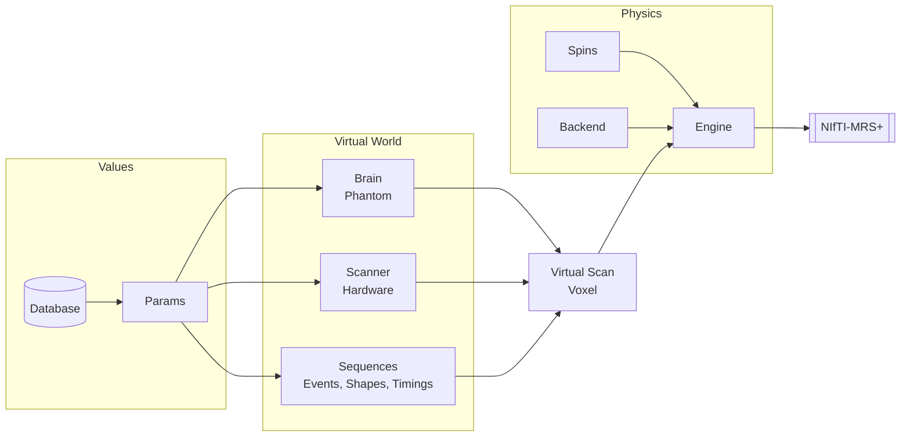

<div align="center">
  
  <h1 style="margin-top: 5px; margin-bottom: 5px;">MRSandbox</h1>
  <p style="margin-top: 0px;"><em>A simulation sandbox for magnetic resonance spectroscopy</em></p>
</div>

---

MRSandbox creates magnetic resonance spectra from first principles. A virtual brain provides the
tissue composition at any voxel position, a virtual scanner provides the field strength and the
hardware limits, and fully flexible pulse sequences probe both through a density matrix engine.
Every quantity is a configurable parameter that can be fixed, sampled from literature ranges, or
read from a quantitative map. The simulations are written with Keras operations and run batched
and differentiable on JAX, PyTorch, and TensorFlow.

```python
brain = Brain.load("icbm152")                      # the MNI average brain, fetched once and cached
scan  = VirtualScan(brain, Scanner.preset("generic_3t"), Press(te1_s=0.011, te2_s=0.019))
data  = scan.voxel(position_mm=(10, -20, 5), size_mm=20).acquire(seed=7)    # NIfTI-MRS
```

> MRSandbox is under active development and grows with my research. It is a personal research toolbox and interfaces are adjusted as we see fit.

## Overview



This repository consists of the following main structures:
* The `mrsandbox/params/` folder holds the parameter system: `Value` providers (fixed, uniform,
  normal, clipped, per tissue, mapped) inside composable `Params` trees. Sampling a tree
  realizes every leaf with one seed and records the ground truth; every leaf draws from its own
  path keyed stream, so adding a parameter never shifts the others. The default priors follow the
  scanner field (1.5, 3, and 7 T relaxation tables).
* The `mrsandbox/database/` folder stores literature values as source named Python dicts with the
  citation beside each dict, including the de Graaf concentration ranges, per metabolite T2 pooled
  from the Gudmundson database in `externals/`, per metabolite T1 typed from Mlynarik 2001,
  Ethofer 2003, and Traber 2004, the published WET and VAPOR suppression series, and the de Graaf
  RF pulse characteristics, and the published functions by which every metabolite shift moves
  with temperature and pH (Wermter et al. 2026). Pooling across sources is code, never data.
* The `mrsandbox/phantom/` folder defines the virtual brain with continuous tissue fractions at
  any position, together with swappable water, lipid, macromolecule, and downfield sources
  (coupled mini spin systems, LCModel style Gaussians, the measured consensus spectrum, or the
  2024 MRSI challenge basis) and B0 field maps that dephase each voxel physically (after a voxel
  shim up to second order, as a real acquisition would). A field map is measured, or computed
  from a susceptibility distribution by the dipole model, so a whole head carries the fields of
  its sinuses and its skull at any field strength. `Volume` is the one spatial container: every
  map, from the tissue fractions to a user's T1 or transmit map, answers box queries with exact
  partial volume weights. ICBM152 (TemplateFlow) and BigBrain-MR (Sainz Martinez et al. 2023)
  are fetched on first use; the QSM challenge 2.0 head (Marques et al. 2021), a whole head with
  skull, air, and scalp, may not be redistributed and is placed in the cache by hand. The wheel
  ships no data.
* The `mrsandbox/resources/` folder pulls large named datasets from their canonical homes on
  first use into a local, checksum verified cache, so the package itself stays lightweight,
  and derives the hMRI demo subject's quantitative 3 T stack (R1, PD, MT saturation, R2*,
  transmit field, B0) and the UK7T travelling head's 7 T stack (DREAM transmit field, B0, R2*
  on five scanners) from their raw scans in cited numpy. The QSM challenge head serves its R1,
  R2*, M0, and susceptibility maps on the grid of its own labels: tissue, field, and relaxation
  of one 7 T subject.
* The `mrsandbox/hardware/` folder describes scanners, the digital receiver, and receive coil
  arrays. Scanner presets carry the peak B1, gradient, and slew limits a design is checked
  against (generic field classes and three 3 T systems). The receiver samples faster than the
  spectral dwell, filters, and decimates, so the first points of a FID carry the filter's onset
  and the noise rolls off at the band edges. Loops carry
  Biot-Savart sensitivities, measured arrays (the BigBrain-MR and T2*-MOVE maps) carry their
  channel patterns, arrays carry the Roemer noise resistance matrix, and acquisitions gain a
  DIM_COIL dimension with the Roemer optimum combination to fold them back.
* The `mrsandbox/sequences/` folder builds sequences as event lists of pulses, delays, gradients,
  and coherence filters. Hard, ideal selective, and shaped pulses (Gaussian, sinc, Hermite,
  hyperbolic secant, Shinnar-Le Roux designs, gradient-modulated GOIA-WURST, or any sampled
  waveform, with or without a slice gradient) share one propagator, gradient crushers dephase an
  isochromat ensemble physically, and named designs compose from the same events: PRESS, STEAM,
  semi-LASER, CHESS, WET, and VAPOR ship with their published series, and J-difference editing
  spans MEGA-PRESS plus the Hadamard-encoded HERMES and HERCULES schemes, whose dual-band editing
  pulses and combination weights ship as typed tables. PRESS, STEAM, and semi-LASER also ship
  with their localization played: slice-selective pulses on three axes, the voxel summed by
  one-dimensional projection (Zhang et al. 2017), so the voxel profile, the chemical shift
  displacement (lactate's lost doublet at TE 144 ms), and the scalp fat a profile reaches
  outside the nominal box all emerge. The b-value of any sequence follows from its own gradient events. Every timing and
  every waveform is a tensor, so sequences can come from your code or from a neural network.
* The `mrsandbox/spins/` folder holds the spin systems and their operator algebra for any
  nuclear spin (protons, deuterium, sodium); the deuterium metabolites of DMI ship as a
  typed set beside the Govindaraju proton systems.
* The `mrsandbox/engine/` folder runs sequences on spin systems and reads out transition lines,
  which render to spectra and FIDs on any grid. A compiled path replays one jitted graph per
  sequence design with every timing as an input, so training draws and a TE series cost
  milliseconds instead of a fresh simulation, and a gradient with respect to a timing flows.
* The `mrsandbox/backend/` folder contains the propagator mathematics. Generic backend utilities
  (jit, autograd) live upstream in NIfTI-MRS+ so that anyone can use them.
* The `mrsandbox/scan/` folder composes everything into `VirtualScan` and `Voxel`, scales up to
  MRSI slices and slabs (a voxel lattice sharing one truth, spatial contrast from the anatomy,
  Cartesian, EPSI, and non-Cartesian trajectories, NIfTI-MRS with real spatial dimensions),
  multiplexes named conditions and transient schedules against one truth, and provides the on
  the fly generators for training. The instrumental imperfections (spurious echoes, eddy
  current phase, drift and motion across transients) are rendered by
  [Augmentrum](https://github.com/julianmer/Augmentrum), installed as the `augment` extra; the
  eddy currents a design's own gradients induce come from the scanner's gradient impulse
  response (a measured 3 T response ships as a resource beside the parametric form), acting
  on the coherences before the readout and on the FID during it.
* The `mrsandbox/io/` folder reads external file formats: the Varian format of the consensus
  macromolecule spectra, and Pulseq `.seq` files (via pypulseq), whose blocks translate into
  the event primitives with the ADC marking the readout, so vendor-agnostic sequences run
  through the engine unchanged.
* The `externals/` folder pins third party resources as git submodules, such as the Gudmundson
  MRS database behind AGNOSTIC.
* The `tests/` folder mirrors the package layout and asserts the physics.

## Validation

Every physical claim in the codebase is gated by a test, and the engine itself is validated
against independent references:

* An in test complex128 oracle shares nothing with the engine but the input values and must
  agree to a relative 1e-3, for ideal and for shaped pulses.
* Clarke's `fsl_denmatsim` runs the same spin systems and sequences and must correlate above
  0.9999, with a derived convention adapter rather than a fitted one. It is pinned as the
  `externals/denmatsim` submodule and installed with `pip install ./externals/denmatsim`.
* Shaped pulse excitation and inversion profiles reproduce the bandwidth length products of
  de Graaf Table 5.1.
* Analytic laws hold exactly where they should: echo attenuation exp(-TE/T2), suppression
  recovery 1 - exp(-t/T1), flip errors cos(flip)^n, and the WET and VAPOR series deliver their
  published T1 and B1 insensitivity.

* The one-dimensional projection equals the full sum over every position pair played one by
  one, on a coupled spin system; the fat layer summed cell by cell through the product of the
  axis profiles equals the design's own voxel average where fat fills the span; and the
  Shinnar-Le Roux pulses hold their slab in the engine's own Bloch run.
